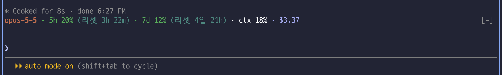

# usage-line

> **`/usage`, `/cost`, `/model` — 명령어 세 개를 한 줄로.**

Claude Code 프롬프트 입력창 바로 위에 현재 모델, 사용량 한도, 컨텍스트 사용률, 세션 비용을 색으로 항상 보여주는 mod.



```
opus-5-5 · 5h 63% (리셋 2h 10m) · 7d 41% (리셋 3일 4h) · ctx 32% · $12.35
```

## 표시 항목

| 항목 | 의미 |
| --- | --- |
| `opus-5-5` | 메인 루프의 현재 모델 (`claude-` 접두사는 뗀다) |
| `5h 63%` / `7d 41%` | 5시간 / 7일 한도 윈도우 사용률과 리셋까지 남은 시간 |
| `ctx 32%` | 컨텍스트 윈도우 사용률 |
| `$12.35` | 이 세션의 모든 API 응답을 API 요금으로 환산한 누적액 (`/cost` 와 같은 값) |

한도 사용률이 80% 이상이면 `!`, 95% 이상이면 `!!` 가 붙는다. 한도 정보가 없으면 `한도 미확인` 으로 표시한다.

## 색 프리셋

`/config` 의 `색 프리셋` 항목(설정 키 `colors`)에서 고른다. 바꾸면 바로 다시 그려진다.

| 프리셋 | 모습 |
| --- | --- |
| `auto` (기본) | 한도 사용률에 따라 초록 / 노랑 / 빨강, 리셋 시간은 남은 시간에 따라 바뀌는 색, 모델은 강조색, 비용은 파란 계열. 테마 색을 따른다 |
| `vivid` | 항목마다 다른 원색: 모델 청록, 한도 초록/노랑/빨강, 리셋 시간은 `auto` 와 같은 단계별 색, 컨텍스트 자홍, 비용 파랑 |
| `mono` | 흐린 단색. 80% 이상인 항목만 굵게 |
| `theme` | 전부 테마 강조색 하나. 80% 이상인 항목만 굵게 |

리셋 시간의 색은 `auto` 와 `vivid` 에서 남은 시간이 줄 때마다 바뀐다. 하루 미만이면 한 시간마다, 하루 이상이면 하루마다 한 단계씩이고, 리셋이 가까울수록 청록, 멀수록 분홍 쪽이다.

| 남은 시간 | 1h 미만 | 1h대 | 2h대 | 3h대 | 4h대 | 5h 이상 |
| --- | --- | --- | --- | --- | --- | --- |
| 남은 일수 | 1일대 | 2일대 | 3일대 | 4일대 | 5일대 | 6일 이상 |
| 색 | 청록 | 하늘 | 파랑 | 남색 | 보라 | 분홍 |

컨텍스트 사용률도 80% / 95% 를 넘으면 `auto` 와 `vivid` 에서 노랑 / 빨강이 된다.

## 경고

각 한도 윈도우가 임계값을 처음 넘을 때 한 번씩 알린다. 윈도우가 리셋되면 다시 알린다.

- 80%: 토스트
- 95%: 토스트 + 데스크톱 알림

## 설치

터미널의 Claude Code 세션에서:

```
/plugin install usage-line --marketplace rockjoon/usage-line
```

마켓플레이스 추가를 묻는 질문에 `y` 로 답하고 스코프를 고르면 바로 켜진다.

## 사용

설치하면 프롬프트 위 띠에 자동으로 나타난다. 끄고 켜는 설정은 세션이 바뀌어도 유지된다. 띠는 `ctrl+x ctrl+a` 로 접을 수 있고, 설문이 띠를 쓰는 동안에는 자리를 내준다. 터미널과 데스크톱 앱에서만 그려진다.

```
/usage-line        # 토글
/usage-line on
/usage-line off
```

## 갱신 시점

타이머로 폴링하지 않고 엔진이 이벤트를 보낼 때 다시 그린다.

- 세션 시작
- 턴 시작과 메인 스레드 턴 종료
- 한도 윈도우가 1%p 이상 움직일 때
- `/usage-line` 실행

그래서 대기 중에는 리셋까지 남은 시간이 멈춰 있고, `/model` 로 바꾼 모델은 다음 프롬프트를 보낼 때 반영된다.

## 호환성

Claude Code 2.1.296 에서 개발하고 테스트했다. 더 낮은 버전에서는 `ui.notify` 가 없어 95% 데스크톱 알림이 뜨지 않을 수 있다.

## 개발

```
claude plugin validate .
claude plugin test .
```

## 라이선스

[MIT](LICENSE)
